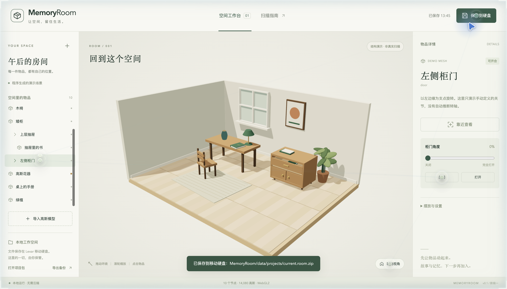
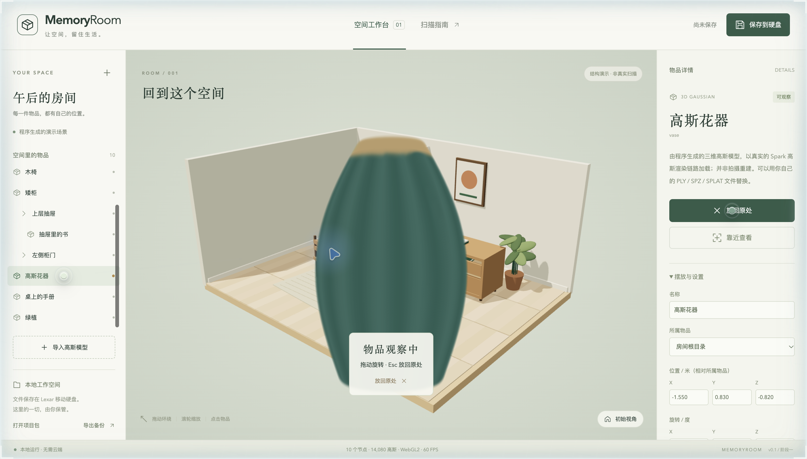
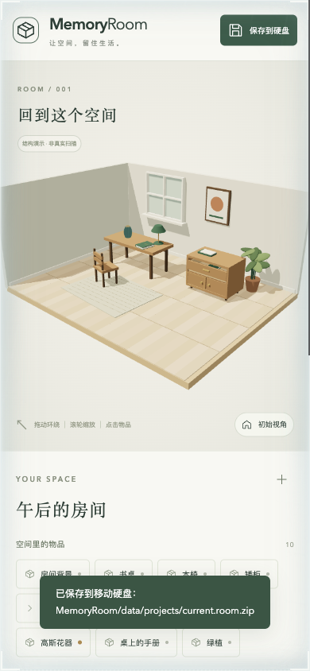
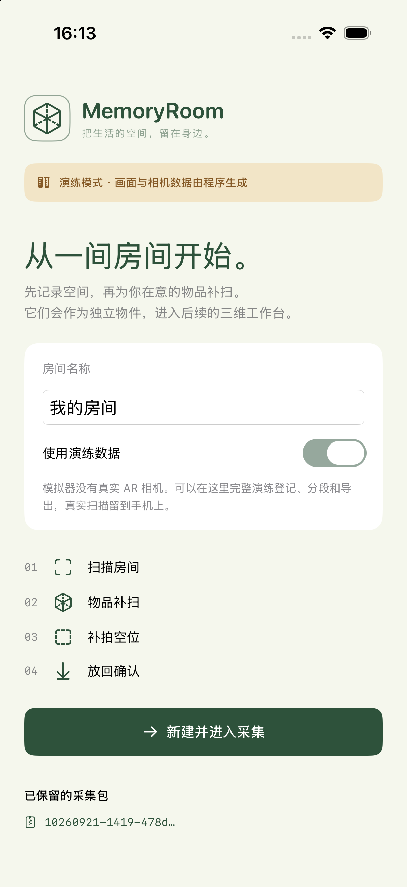
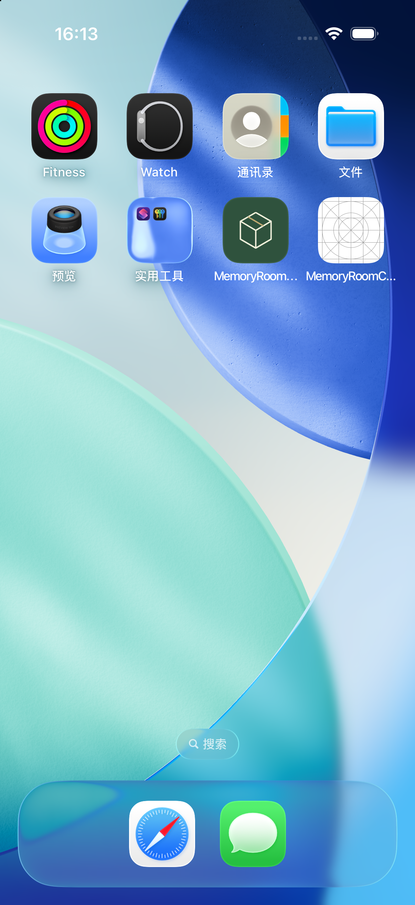
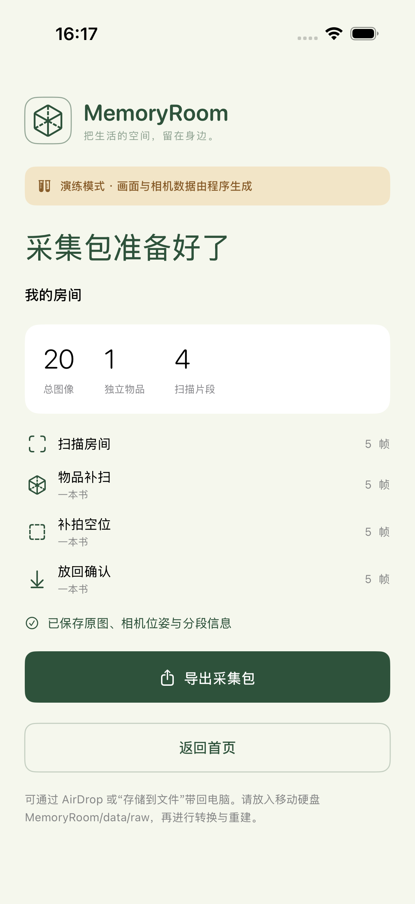

<div align="center">

# 🏠 MemoryRoom — Rooms That Remember You

**Scan a room into 3D Gaussian Splats, then pin your memories to the things inside it.**

English · [简体中文](README.zh-CN.md)

   



</div>

## What is it?

MemoryRoom turns the place where you live into a **walk-around, touch-and-open 3D space** — and lets you attach memories (notes, photos, voice, dates) to the objects in it. Open a drawer and the book inside comes with it. Pick up a vase, turn it in your hands, put it back exactly where it was.

The goal is not another "3D scan viewer". It is a *memory room*: a space that stays with you.

- **Space** — captured with an iPhone (guided scan) and reconstructed as a 3D Gaussian Splat.
- **Objects** — independent items with hierarchy (a book belongs to a drawer), joints (drawer slides, cabinet doors rotate), and "pick up & inspect" behaviour.
- **Memories** — cards with text, photo and audio attachments, anchored to clickable points.

> ⚠️ **Honest status:** this is an early prototype. The demo room in the screenshots is a procedurally generated mesh scene and a generated 14,080-Gaussian vase — **not a real scan**. A first real room has been reconstructed end-to-end (≈1M Gaussians, 236 MB), but its visual quality is **not yet good enough**; improving capture input quality is the current top priority.

## Gallery

| Pick up & inspect an object | Mobile layout |
|:--:|:--:|
|  |  |

| iOS guided capture app (v0.4.0, Simulator demo data) |
|:--:|
|    |

## Features today

- 3D room orbit / zoom / keyboard pan in the browser, rendered with **[Spark](https://sparkjs.dev) 2.3.1** (Three.js).
- Import Gaussian **PLY / SPZ / SPLAT / KSPLAT** and GLB with embedded textures.
- Independent object picking, "pick up & inspect", drag-rotate, exact return-to-place.
- Joints: sliding drawers, rotating cabinet doors; children follow their parent.
- Edit name / position / angle / scale / parent / simple joints.
- Memory cards with attachments, multiple spaces, **full history snapshots** on every save.
- Portable `.room.zip` project packages (import / export).
- Checked data-conversion tools (explicit camera coordinates, RGBA objects, background-exclusion masks).
- iOS guided-capture app (ARKit) that exports a capture bundle for reconstruction.

## Progress

| Area | State |
|---|---|
| Web viewer, scene graph, joints, memory cards, snapshots | ✅ working prototype |
| iOS guided capture app | ✅ v0.4.0 (build 4); real-device guidance iterations ongoing |
| Phone → Mac / school-GPU reconstruction (OOOSplat) | ✅ first real room done end-to-end |
| Reconstruction quality of real rooms | 🟡 below target — limited by input (≈1 fps frames, auto-exposure, motion blur) |
| Automatic object segmentation, independent object training, clean background, registration | ⬜ not implemented |
| Remote executor, on-phone training, commercial APIs | ⬜ interfaces and plans only |

Details: [docs/STATUS.md](docs/STATUS.md) · [Retrospective 2026-10-27](docs/MemoryRoom_截至2026-10-27_已完成阶段与尝试复盘.md).

## Roadmap

1. **Fix input quality** — native 4K camera capture, locked exposure, a controlled A/B "only change the input" benchmark on the same pipeline.
2. **Layered architecture** (G0–G4 gates, two weeks, one desk + one cabinet): 3DGS background + Apple Object Capture meshes for items + parametric doors/drawers; capture order *objects first → move them → scan the background*.
3. Gravity-aligned scenes (RANSAC ground fit), contribution-based pruning to SPZ, per-Gaussian reveal effects in Spark.
4. Independent object segmentation (SAM-class) and per-object training.

## Quick start

Requires Node.js ≥ 22.12.

```sh
npm ci
npm run dev        # http://127.0.0.1:4317  (local only)
npm run build      # type-check + production build
npm test           # scene / package tests
```

Try this: select **Gaussian vase → Pick up** → drag to rotate → **Put back**; open the **upper drawer** and see the book travel with it; **Save to disk** and reload — the open/closed state persists.

## Repository layout

```text
apps/viewer/            web viewer, Spark rendering, local file saving
apps/capture-ios/       iPhone guided-capture app (Xcode project)
packages/scene/         scene format, joints, inspect/return, project packages
tools/                  dataset conversion, reconstruction jobs, school-GPU helpers, QA
docs/                   architecture, capture contract, status, research notes (mostly Chinese)
```

## Documentation

Most documents are written in Chinese (the author's working language). Key entry points:
[Architecture](docs/ARCHITECTURE.md) · [Capture contract](docs/CAPTURE.md) · [iOS setup](docs/IOS_SETUP.md) · [Why not UE5 first](docs/ENGINE_DECISION.md) · [Space & memory framework](docs/空间与记忆框架_2026-10-26.md) · [Upstream sources](docs/UPSTREAM.md) · [Full dev log (zh)](docs/DEVELOPMENT_LOG.zh-CN.md) · [Research notes](docs/research/).

## Credits

Built on [Spark](https://github.com/sparkjsdev/spark), [Three.js](https://threejs.org), OOOSplat/Brush-family trainers and many open-source ideas — see [THIRD_PARTY_NOTICES.md](THIRD_PARTY_NOTICES.md) and [docs/UPSTREAM.md](docs/UPSTREAM.md).

## License

[MIT](LICENSE) © 2026 Zeran Wang
