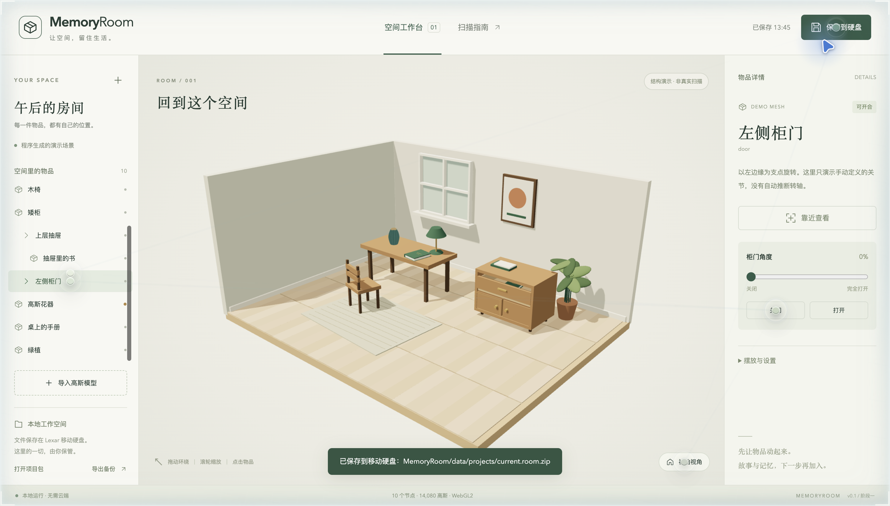
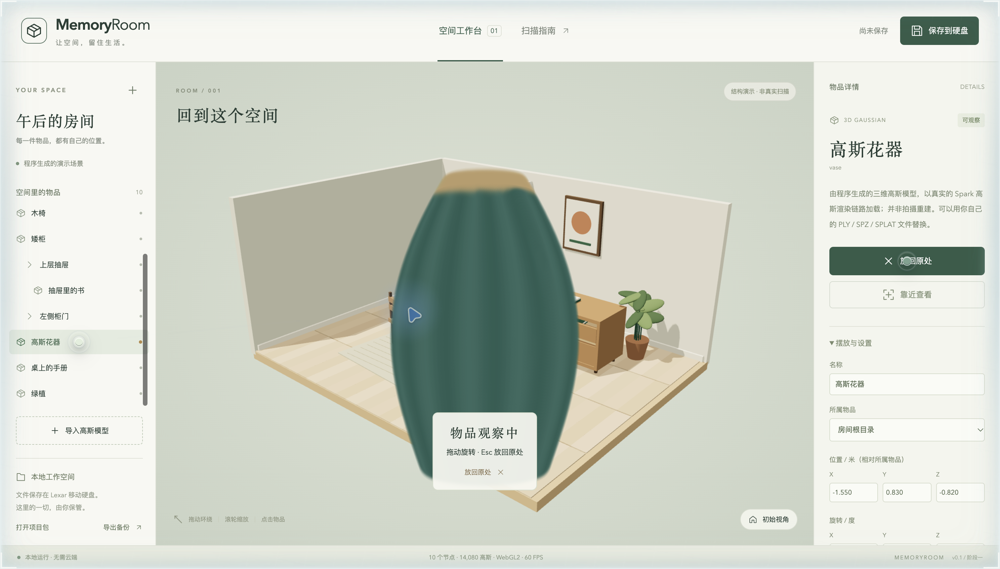
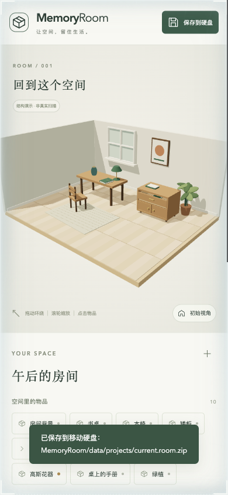
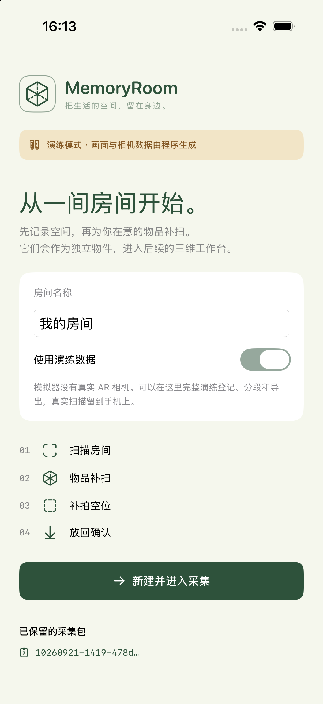
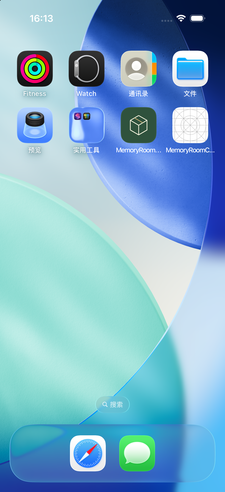
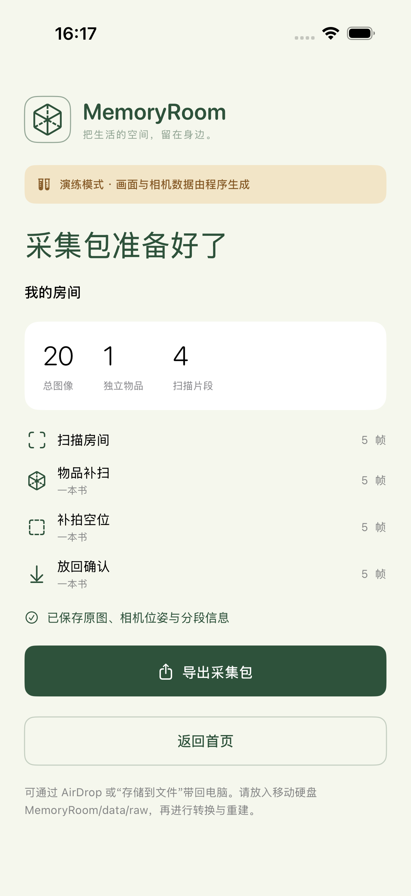

<div align="center">

# 🏠 MemoryRoom · 房间会记得你

**把房间扫成 3D 高斯泼溅，再把你的记忆，钉在房间里的每一件东西上。**

[English](README.md) · 简体中文

   



</div>

## 这是什么

MemoryRoom 想把你生活的空间，变成一个**能走进去、能伸手拨弄的 3D 房间**，并让你把记忆（文字、照片、录音、日期）挂在房间里的物品上。拉开抽屉，里面的书跟着滑出来；拿起花瓶，在手里转一转，再原样放回去。

它不是又一个"3D 扫描查看器"，而是一间**留得住记忆的房间**。

- **空间**：用 iPhone 引导式扫描，重建成 3D 高斯泼溅。
- **物品**：可独立选取，有层级（书属于抽屉）、有关节（抽屉滑动、柜门旋转），可"拿起观察"。
- **记忆**：带文字、照片、音频附件的卡片，挂在可点击的记忆点上。

> ⚠️ **如实说明**：这是早期原型。截图里的房间是程序生成的网格场景，花器是程序生成的 14,080 个高斯，**都不是实际扫描成果**。真实房间已经完整跑通过一次（约 100 万高斯、236 MB），但画质**还没达到满意**，当前首要任务是提升采集输入质量。

## 画面

| 拿起物品观察 | 手机窄屏 |
|:--:|:--:|
|  |  |

| iOS 引导采集 App（v0.4.0，模拟器演练数据） |
|:--:|
|    |

## 现在能做什么

- 网页里三维房间环绕、缩放、键盘平移，使用 **[Spark](https://sparkjs.dev) 2.3.1**（基于 Three.js）渲染。
- 导入 Gaussian **PLY / SPZ / SPLAT / KSPLAT** 以及带内嵌贴图的 GLB。
- 独立物品选取、"拿起观察"、拖动旋转、精确归位。
- 关节：抽屉滑动、柜门旋转，子物品跟随父物品。
- 编辑名称、位置、角度、缩放、父物品和简单关节。
- 记忆卡片与附件、多空间、**每次保存留存完整历史快照**。
- 可移植的 `.room.zip` 项目包（导入 / 导出）。
- 带检查的数据转换工具（明确相机坐标、RGBA 物品、背景排除蒙版）。
- iOS 引导采集 App（ARKit），导出采集包用于重建。

## 目前进度

| 模块 | 状态 |
|---|---|
| 网页查看器、场景图、关节、记忆卡片、历史快照 | ✅ 可用原型 |
| iOS 引导采集 App | ✅ v0.4.0（build 4），真机引导持续迭代 |
| 手机 → Mac / 学校 GPU 重建（OOOSplat） | ✅ 第一间真实房间已端到端跑通 |
| 真实房间的重建画质 | 🟡 未达目标：受输入限制（约 1 帧/秒、自动曝光、运动模糊） |
| 自动物品分割、独立物品训练、干净背景、配准 | ⬜ 尚未实现 |
| 远程执行器、手机本地训练、商业 API | ⬜ 仅有接口与计划 |

详见 [docs/STATUS.md](docs/STATUS.md) · [2026-10-27 全阶段复盘](docs/MemoryRoom_截至2026-10-27_已完成阶段与尝试复盘.md)。

## 路线图

1. **先解决输入质量**：原生相机 4K、锁定曝光，在同一条流水线上做"只换输入"的对照实验。
2. **分层组合架构**（G0–G4 验收门槛，两周、一张桌子加一个柜子）：3DGS 背景 + Apple Object Capture 网格物品 + 参数化柜门；采集顺序"先拍物品 → 移走 → 再扫背景"。
3. 重力对齐（RANSAC 地面找平）、按贡献精简并转 SPZ、Spark 逐高斯动效（进入浮现、检查物品时背景变暗）。
4. 独立物品分割（SAM 类）与逐物品训练。

## 快速开始

需要 Node.js ≥ 22.12。

```sh
npm ci
npm run dev        # http://127.0.0.1:4317（仅本机）
npm run build      # 类型检查 + 构建
npm test           # 场景 / 项目包测试
```

试试：选择**高斯花器 → 拿起观察** → 拖动旋转 → **放回原处**；打开**上层抽屉**，看书跟着滑出；点**保存到硬盘**后刷新页面，开合状态仍在。

## 目录结构

```text
apps/viewer/            网页、Spark 渲染与本地文件保存
apps/capture-ios/       iPhone 引导采集 App（Xcode 工程）
packages/scene/         场景格式、关节、观察归位、项目包
tools/                  数据转换、重建任务、学校 GPU 辅助脚本、QA
docs/                   架构、采集约定、状态、调研笔记（以中文为主）
```

## 文档入口

[架构](docs/ARCHITECTURE.md) · [采集接口](docs/CAPTURE.md) · [iOS 安装与演练](docs/IOS_SETUP.md) · [一期为什么先不接 UE5](docs/ENGINE_DECISION.md) · [空间与记忆框架](docs/空间与记忆框架_2026-10-26.md) · [上游来源](docs/UPSTREAM.md) · [完整开发日志](docs/DEVELOPMENT_LOG.zh-CN.md) · [调研笔记](docs/research/)。

## 致谢

基于 [Spark](https://github.com/sparkjsdev/spark)、[Three.js](https://threejs.org)、OOOSplat / Brush 系列训练器等开源成果，见 [THIRD_PARTY_NOTICES.md](THIRD_PARTY_NOTICES.md) 与 [docs/UPSTREAM.md](docs/UPSTREAM.md)。

## 许可证

[MIT](LICENSE) © 2026 Zeran Wang
