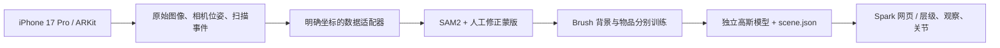

> 2026-10-25 更新：当前以 [第一批使用说明](第一批开发与实拍使用说明.md) 为准。以下保留旧版背景；其中自动验收、64 MB、强制覆盖门槛等描述已由第一批实现替代。新版未运行测试或构建。

# 一期架构

原则：外观看起来是同一个房间，内部保持可独立寻址的多个资产。不把所有东西永久熔进一个 PLY。

## 已实现的边界

`packages/scene/src/schema.ts`：版本化的米制、右手 Y-up 场景；稳定编号、资产路径、局部变换、父子层级、交互类型和关节。拒绝循环层级、缺失资源、重复编号、无效缩放与路径越界。

`interactions.ts`：观察时临时将物品放在相机前，保存原父物品与局部变换；退出时完全恢复。关节使用绝对开合比例，避免累计误差。父物品移动自然传递给子物品。

`apps/viewer/src/viewport.ts`：Three.js 普通几何和 Spark 高斯混合显示；先异步加载完整候选场景，成功后替换，失败保留原场景。高斯与网格都参与选取和包围盒计算。

`bundle.ts`：场景与原始模型一起打包。v0.1 限 64 MB 解压后内容，优先验证轻量数据。场景文件从不引用外网地址。

本地保存端是 Vite 开发/预览中间件，监听 loopback，写入固定目录；写临时文件后原子重命名，并保留前一版。它不是云端生产服务。

## 尚待接入

- 手机采集 UI：房间扫描、开始物品片段、空位补拍、放回确认。整个过程尽量保持同一 AR 会话。
- SAM2 的交互提示与结果修正；不能把蒙版当作物体 6D 姿态。
- Brush 的版本固定、任务启动、日志、取消和训练参数。object 模式需要透明 alpha 与 alpha matching；room 模式需要 masked loss。
- 自动/半自动放回定位、关节支点编辑与碰撞代理。
- 大场景 LOD/分块、手机实测和功耗；当前没有全屋手机性能结论。

## 不能隐含跳过的问题

物品自身移动时，单靠相机位姿不能训练静态物品；每个物品片段须固定，移入/移出与翻面过渡帧应排除。翻面后的段落需要新的对象对齐，不能直接合并。

从背景排除原物品后，被遮挡表面需要补拍；导入一个独立模型不会自动清除原背景中的同一个物品。

扫描开合动作不自动产生关节。v0.1 手动定义滑动方向/角度，旋转支点先使用校准后的模型原点。

## 后续扩展

记忆、文字、网页、相册、日期版本以稳定 node id 关联，后期新增独立内容表；当前不接大模型，不生成虚构记忆。
