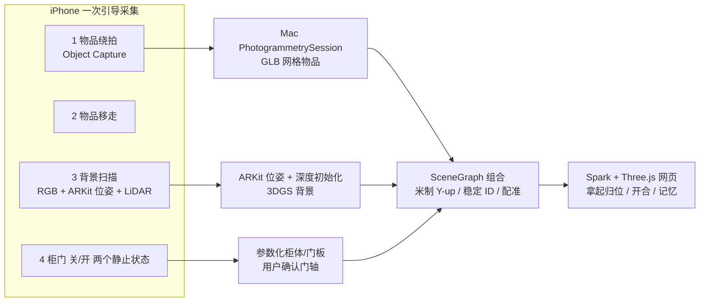

# MemoryRoom：路线收敛与分层架构决定

> **事实更正（2026-10-27）：本文关于“没有训练完成的高斯成片”“效果不好没有高斯结果支撑”的表述错误。后续正式OOOSplat作业47102、47113已经完成；本地`data/processed/gpu-results/ooosplat_1ebc5b7a/final.ply`已存在，用户已查看并反馈画质未达标。本文原有内容保留作历史建议，不作为当前执行状态；ARKit/Splatfacto替代、测试策略和两周工期也不是因此已经获准或实施。当前事实以[阶段复盘](/Volumes/Lexar/MemoryRoom/docs/MemoryRoom_截至2026-10-27_已完成阶段与尝试复盘.md)及最新STATUS为准。**

日期：2026-10-27。本文基于已读的 README、架构、空间与记忆框架、STATUS 及 10-25 至 10-26 的调研文档，做一次总审查与收敛。没有新增外部检索，没有运行训练、测试或构建。

## 一、结论

**停止扩大调研，固定“分层组合”路线，用两周拿到第一份可验收的真实成片。** 每一层用最成熟、最便宜的现成工具，自研只做“组合 + 记忆 + 交互”。

| 层 | 选定方案 | 不再作为主线 |
| --- | --- | --- |
| L1 空间背景 | 3DGS。先用已准备好的 ARKit 位姿 + LiDAR 初始化跑出第一份；同一角落用 Scaniverse Splat 模式（导出 SPZ，不是 GLB 网格）做画质参照 | 自研训练器、世界模型生成房间、全景替代 |
| L2 可拿物品 | Apple Object Capture（iPhone 采集，Mac 上 PhotogrammetrySession 生成）→ USDZ → GLB 网格 | 从整屋高斯里自动切物品、单图生成 3D（SAM 3D / PartCrafter / MIDI） |
| L3 柜门抽屉 | 参数化网格（按 LiDAR/RoomPlan 尺寸）+ 实拍贴图 + 用户确认门轴与行程 | 自动关节推断（Ditto、Articulate Anything） |
| L4 干净背景 | 改采集顺序：先拍要拿的物品 → 移走 → 再扫背景 | AI 补洞作为默认 |
| L5 运行端 | 现有 Spark + Three.js + SceneGraph + 记忆系统，不动 | UE5 / Unity、Blender 渲染进运行链路 |

Agent + Blender（含 LiteReality-Agent）只作为 L3 的可选加速器，不作底座。这与 10-26 的社区评分一致（分层组合 7.2，高于高斯主导 6.6 和 Agent 整屋 6.1），这里把它从“推荐”变成“决定”。

## 二、为什么效果不好：多数问题还没测到技术上限

1. **没有一份真正训练完成的高斯成片。** 学校作业 47074 的 COLMAP 只注册了 33/493 张（6.69%），高斯训练从未开始；47080 是参数错误，28 秒退出。到目前为止，“3DGS 效果不好”这个判断没有任何高斯结果支撑。
2. **位姿是第一瓶颈。** COLMAP 初始焦距 2304 px，ARKit 实测约 1358 px，差约 1.7 倍；手机视频帧做穷举匹配，也容易断成多个子模型。已有的 `prepare_arkit.py` 绕过了这一步，是最快能出结果的路径。
3. **比较对象错了。** 用户看到的 Scaniverse 结果是 GLB 网格（页面显示 0 高斯），不是 Splat。网格的边缘和文字本来就弱，不能代表高斯画质。
4. **方向混乱是接收端缺陷。** 导入时旋转默认为 0，没有地面和朝向校准。这是代码问题，重扫也解决不了。
5. **路线摆动。** 两天内依次转向高斯、Agent-Blender、世界模型、全景、商业产品，每次底座都没打牢。14 份调研的结论高度一致：没有一站式方案，要分层。
6. **流程本身没有闭环。** 约定“只写代码，不运行验证”，导致 STATUS 里几乎每条都是“未验证”。AI 写的采集、转换、训练脚本必须跑一遍才能发现问题，例如参数名错误。

## 三、架构

关键设计：

- **背景天然干净。** 物品在背景扫描前已经移走，拿起后不会留下高斯“重影”，也不需要从整屋模型里切分。代价是用户要搬一次物品，这一步只对“要拿的少数重点物品”做。
- **物品用网格。** 拿起、旋转、碰撞、归位都需要干净的独立几何；Object Capture 在 Apple 设备上免费、本机运行，带贴图，适合 iPhone 17 Pro + Mac 的组合。高斯物品放到二期，作为外观升级。
- **配准。** 物品放回原位：先用采集时的 ARKit 世界坐标初步定位（同一 AR 会话或 ARWorldMap 重定位），再在工作台手动微调。不追求全自动。
- **“平民化”的含义。** 用户只拿 iPhone，计算在 Mac 或远端完成；用户需要做的只是“按引导拍 → 移走几件东西 → 再扫一遍”。

## 四、两周计划与验收门槛

范围固定为一个角落：一张桌子、一个柜子（一扇门）、桌上 3 件物品。每步不通过就停在这一步，不进下一步。

| 步骤 | 内容 | 通过标准 |
| --- | --- | --- |
| G0（1–2 天） | 修导入朝向/地面校准；把工作约定改成“每个脚本至少真实跑一次” | 同一 PLY 导入后地面水平、朝向正确 |
| G1（3–4 天） | 同一角落出两份背景：ARKit 位姿 Splatfacto、Scaniverse Splat SPZ。留出 5 张不参与训练的照片做对比 | 至少一份柜面纹理、地面接缝可接受；记录总耗时 |
| G2（3 天） | 3 件物品 Object Capture → GLB → 导入 → 拿起 → 归位 | 尺度误差肉眼不可见；归位后无重影、无漂浮 |
| G3（2–3 天） | 参数化柜体 + 一扇门 + 门内一件物品，绑定一条记忆 | 开门不穿插，门内物品不跟门转，记忆 ID 在替换模型后保留 |
| G4 | 以上全部通过后，才讨论 Agent 自动化、几分钟出图、手机本地训练 | — |

G1 如果 ARKit 位姿结果出现明显重影，说明位姿有漂移。下一步是 COLMAP 固定已知内参，改用顺序匹配加回环检测（或 GLOMAP），不是换渲染器或换整条路线。是否在学校跑 gsplat/Splatfacto 作为对照，需要用户确认，因为它不同于 AGENTS.md 中规定的 OOOSplat 主线。

## 五、产品定位提醒

重建本身已有成熟玩家：Scaniverse、LCC Scan、Polycam、Aholo（Aholo 还明确做“生活记忆”）。MemoryRoom 的差异应该放在**真实空间里的可交互记忆**上，也就是独立物品、开合、记忆绑定、版本和项目包。重建层用现成工具，并保持可替换：任何一层将来有更好的方案，只替换那一层的资产，记忆数据不动。现有 SceneGraph 和“替换为真实模型”已经支持这种做法。
