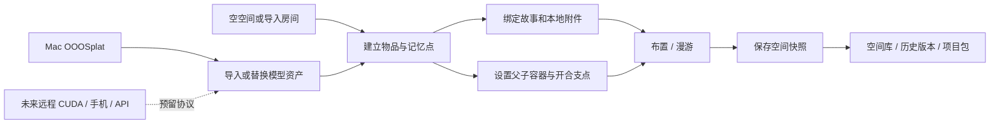

# 空间与记忆框架

日期：2026-10-26。本轮从前一日开始实施。按用户要求，仅编写和阅读源码、查阅公开资料，没有新增或运行测试、构建、演练、训练、重建或浏览器验证；没有连接学校 VPN / SSH、上传素材或调用商业生成服务。本文的“已实现”指代码实现，不能代替用户实际使用的验收。

## 不等高斯模型也能做的部分

| 模块 | 本轮实现范围 | 与重建的关系 |
| --- | --- | --- |
| 空间库 | 多个空间、重命名、另存副本、历史版本、打开旧版本后继续保存 | 不依赖重建；空空间也能存记忆 |
| 记忆内容 | 标题、正文、时间、标签、照片、音频、视频、PDF 附件、网页链接、关联空间 | 不依赖重建；附件本地保留 |
| 录音与整理 | 浏览器主动授权后录音、导入录音、固定提问辅助写故事 | 不调用语音识别、LLM 或商业 API；转写和智能访谈未实现 |
| 内容检索 | 当前空间按正文、标题、时间文本、标签及物品名检索；按绑定物品筛选 | 不依赖重建；没有向量模型依赖 |
| 物品与内容绑定 | 稳定物品编号、父子容器、空间故事、可点击记忆点 | 先建记忆点/容器，随后加入模型 |
| 模型替换 | 替换独立节点的模型，保留编号、记忆、变换、父子关系和开合参数 | 需要后续导入模型文件，不要求重跑内容系统 |
| 柜门和抽屉 | 滑动轴/行程、旋转轴/角度、自定义旋转支点、内部物品跟随 | 需要独立几何或独立高斯部件；没有自动切割整屋模型 |
| 漫游与布置 | 布置时显示全部内容；漫游时按开合条件显示物品和记忆 | 与训练器无关；条件是交互规则，不是物理遮挡或访问权限 |
| 本地后端 | 空间列表、快照读取、版本保存、写入冲突提示、生成方式目录、接入计划保存 | 不依赖训练；保留旧版本和旧文件 |
| 生成服务协议 | 统一请求、阶段状态与输出资产类型；Mac、远程 CUDA、手机本地和商用入口声明 | Mac 仍走已有交接；后三者没有自动执行器 |

## 主流程



内容系统用空间 ID、物品 ID 和资产 ID 关联，不用高斯点的序号。训练器更换、模型替换后，只要保持同一物品节点，记忆无需重写。

## 现在的操作入口

### 1. 建立空间与内容

顶部“空间库”管理已保存空间，左侧“＋”建立空空间。“添加记忆点 / 容器”可先创建内容位置；记忆点是用户设置的标记，不伪装成扫描物品。它出现在当前视线目标处，位置可在右侧设置。

顶部“记忆”显示当前空间卡片；选中物品后的“相关记忆”按该物品筛选。可保存文字、日期、标签、附件和网页链接；记忆既可以绑定物品，也可以不绑定任何物品，成为空间故事。

卡片编辑器有“它是怎么来到这里的”“和谁有关”“为什么值得留下”等固定提问。它们只是写作提示，不会自动生成用户经历。录音需由用户点击并授予浏览器麦克风权限；音频不自动转写、不上传。

“保存卡片到当前空间”先更新正在编辑的空间，**再点击主界面“保存到硬盘”才持久保存**。关闭未保存的卡片编辑会提示；空间有未保存修改时离开页面会提示。

附件上限每份 20 MB、每卡片 30 份，模型与附件合计仍受现有 256 MB 项目包限制。支持 JPEG、PNG、WebP、MP3、WAV、OGG、M4A、MP4、WebM 和 PDF。照片、音频和视频可在卡片中查看/播放；PDF 当前提供下载，尚无逐页书籍阅读器。视频能否播放还取决于浏览器的编码支持。附件没有压缩转码或内容识别。

### 2. 模型生成后接入

如果已经在空空间中做了记忆和物品框架，继续在这个空间中导入模型，或者选中预留的节点后点击“替换为真实模型”。不要把“打开另一个完整重建项目包”当成自动合并现有内容；打开整包是在切换项目。

替换模型保留物品 ID、记忆、父子关系和开合设置。模型坐标、尺寸和支点仍需人工调整；新的模型不会自动与旧模型配准。替换只表示换资产，不表示完成物品分割、网格内部拆分或干净背景修复。

### 3. 柜门、抽屉及内部记忆

1. 导入独立柜门/抽屉资产；单独的部件文件是前提。
2. 右侧交互方式选择“旋转部件”或“滑动部件”。设置运动轴、最大角度或行程。旋转支点是相对部件原点的本地坐标，随统一缩放变化；旋转轴为部件局部轴，滑动方向沿父物品坐标轴。
3. 内部物品需要随抽屉移动时，把“所属物品”设为这个抽屉。固定柜内物品则可属于柜体，由柜门控制显示，避免跟着门一起旋转。
4. 在内部物品的“何时显示”或记忆卡片的“何时可见”中，选择对应柜门/抽屉，并设置打开比例。
5. 点击“进入漫游”。此时条件生效；返回布置后，可再次编辑全部物品和卡片。

父物品不可访问时，其子物品及绑定的记忆也不展示。没有配置条件时不自动猜测物品是否在柜子内。删除关节前，要先解除引用它的显示条件；删除物品时保留它的记忆为不绑定物品的空间故事，解除失效的开合条件。

静态整屋高斯中的原柜门不会因为添加了一个可转动部件而消失。还需要背景去重或干净背景重建。当前系统也不生成柜体内部或物理碰撞；“打开后显示”是明确设置的交互行为。

### 4. 保存与版本

每次保存写一个不可变的完整 `.room.zip` 快照。空间库展示各空间最新版本，历史版本可单独打开。打开历史版本后保存会新增版本，不重写历史文件。

多个窗口同时编辑同一空间时，保存请求携带读取时的版本标记；如果硬盘已有更新版本，返回冲突提示。当前编辑仍留在页面，可导出备份或另存为新空间。单独导入来自外部的同 ID 项目包不会静默覆盖空间库版本。

旧 `data/projects/current.room.zip` 和 `previous.room.zip` 保留，没有迁移删除；新保存使用下方空间库。首次没有新指针时，启动仍尝试读取旧 current 文件。旧文件要进空间库，打开后正常保存一次即可。

## 文件组织与接口

新空间库：

```text
data/projects/
  current-pointer.json              当前空间/版本指针
  current.room.zip                  原版本文件，保留作为首次读取回退
  previous.room.zip                 原历史文件，保留
  library/<空间ID的哈希>/
    head.json                       此空间的最新版本摘要
    <快照ID>.json                   版本摘要
    <快照ID>.room.zip               不变的完整空间包
data/processed/reconstruction-requests/
  <计划ID>.json                     仅接入计划，状态 draft
```

空间包继续兼容 v1/v2 的读取，新记忆存放在 `contents.json`；布局在 `scene.json`，开合状态在 `state.json`，模型和附件在 `assets/`。旧项目没有记忆字段时视为空内容。**含新内容的包应使用本轮或更高版本打开保存；旧应用可能忽略新增字段。**

| 接口 | 用途 |
| --- | --- |
| `GET /api/library` | 空间最新版本列表 |
| `GET /api/library/:key/revisions` | 此空间历史快照 |
| `GET /api/library/:key[/snapshot]` | 读取最新或指定版本项目包 |
| `GET /api/projects/current` | 新指针指向的项目；没有新指针时读取旧文件 |
| `PUT /api/projects/current` | 带本地请求标记和基础版本标记保存新快照 |
| `GET /api/reconstruction/providers` | 生成方式与接入状态 |
| `GET /api/reconstruction/requests` | 读取后续接入计划 |
| `POST /api/reconstruction/requests` | 保存计划，不启动任务 |

本地接口仅允许工作台 loopback 主机与同源请求；变更操作要求本地请求头。浏览器不会得到任意文件读取、任意命令执行或 SSH 密钥保存接口。后续服务器适配器不能把请求中的文字直接当 shell 命令。

生成协议见 `packages/scene/src/providers.ts`：输入包含空间/采集身份、用途、生成方式、质量档和备注；进度区分排队、运行、完成、失败、取消及阶段；资产明确格式、来源、尺度和警告。**“保存计划”不是“排队等待自动训练”**。

## 当前阶段和后续依赖

已写完本批无需真实重建结果的基础闭环：空空间 → 物品/记忆点 → 内容 → 手动开合和显示规则 → 版本保存 → 再次读取/导出。

仍需真实资产或独立实现的部分：

- 真正的房间成片质量、物品自动分割、独立物品训练、柜门切分、干净背景和坐标配准。
- 服务器实际执行器、学校调度器配置、GPU 软件环境和断点续训；当前只做契约、计划与耗时分析，没有远程提交能力。
- 自动访谈、语音转写、语义检索、书页识别、细粒度时间版本对齐和自动关节推断。
- 手机本地训练、商业 API、云同步、账号共享、物理碰撞、大模型流式加载。

以上没有借用“接口已留好”来宣称功能已完成。本轮不验证代码，实际运行与反馈由用户完成。
